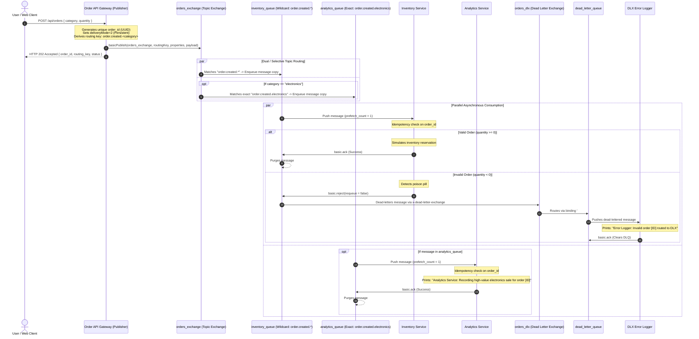

# E-Commerce Order Processing System (RabbitMQ Event-Driven Architecture)

[](https://openjdk.org/)
[](https://spring.io/projects/spring-boot)
[](https://www.rabbitmq.com/)
[](https://www.amqp.org/)
[](LICENSE)

An enterprise-grade, asynchronous E-Commerce Order Processing System built with **Java 21**, **Spring Boot 3**, and **RabbitMQ (AMQP 0-9-1)**. 

This project demonstrates core event-driven architectural principles, dynamic message routing using a **Topic Exchange**, safe poison pill handling with a **Dead Letter Exchange (DLX)**, true workload leveling via **Fair Dispatch (QoS Prefetch = 1)**, **Manual Acknowledgments**, and **Idempotent Consumer Deduplication**.

---

## Table of Contents
1. [Architectural Overview](#architectural-overview)
2. [System Topology & Message Flow Diagrams](#system-topology--message-flow-diagrams)
3. [Key Concepts & Architectural Alignment](#key-concepts--architectural-alignment)
4. [Prerequisites & Quickstart](#prerequisites--quickstart)
5. [Interactive Web UI & REST API Guide](#interactive-web-ui--rest-api-guide)
6. [Automated Verification & Execution Proof](#automated-verification--execution-proof)
7. [Visual Evidence & Screenshot Gallery](#visual-evidence--screenshot-gallery)
8. [Production Best Practices Applied](#production-best-practices-applied)

---

## Architectural Overview

In traditional synchronous architectures (e.g., direct REST calls), microservices block waiting for downstream systems. If a non-critical downstream service (like email or analytics) fails or experiences latency, the entire checkout pipeline crashes or hangs, causing HTTP 500 errors.

This system decouples the checkout flow:
* **Asynchronous Offloading:** The Order API validates incoming requests, publishes an `order_placed` event to a RabbitMQ Topic Exchange, and returns an immediate **HTTP 202 Accepted** response (< 15 ms latency).
* **Topic Routing:** The Exchange inspects routing keys (`order.created.<category>`) and delivers copies of the event to independent queues concurrently.
* **Resilient Failure Handling:** Malformed or invalid orders (e.g., negative quantity) are explicitly rejected by workers with `requeue = false`, immediately routing them to a Dead Letter Exchange without consumer CPU throttling or infinite loops.

```
+---------------------------------------------------------------------------------------------------------------------+
|                                               SYSTEM ARCHITECTURE                                                   |
+---------------------------------------------------------------------------------------------------------------------+
|                                                                                                                     |
|   +--------------------+               +------------------------------------------------------------------------+   |
|   |  Web UI / Client   |               |                            RABBITMQ BROKER                             |   |
|   +---------+----------+               |                                                                        |   |
|             | HTTP POST /api/orders    |  +--------------------+                                                |   |
|             v (Instant 202 Accepted)   |  |   orders_exchange  | (Topic Exchange)                               |   |
|   +--------------------+               |  +---------+----------+                                                |   |
|   | Order API Service  |               |            |                                                           |   |
|   | (Publisher)        |==============>|            |-- order.created.* ----------------+                       |   |
|   +--------------------+  AMQP 0-9-1   |            |                                   |                       |   |
|                                        |            |-- order.created.electronics       |                       |   |
|                                        |            |                                   v                       |   |
|                                        |            v                         +-------------------+             |   |
|                                        |  +-------------------+               |  inventory_queue  |             |   |
|                                        |  |  analytics_queue  |               |  (DLX Configured) |             |   |
|                                        |  +---------+---------+               +---------+---------+             |   |
|                                        +------------|-----------------------------------|-----------------------+   |
|                                                     |                                   |                           |
|                                                     | AMQP Push                         | AMQP Push                 |
|                                                     v                                   v                           |
|                                           +-------------------+               +-------------------+                 |
|                                           | Analytics Service |               | Inventory Service |                 |
|                                           | (Logs high-value) |               | (Simulates reserve|                 |
|                                           +-------------------+               |  qty < 0 => DLX)  |                 |
|                                                                               +---------+---------+                 |
|                                                                                         |                           |
|                                                                                         | basic.reject              |
|                                                                                         | (requeue=false)           |
|                                                                                         v                           |
|                                        +------------------------------------------------|-----------------------+   |
|                                        |  +--------------------+                        | (Dead Letter Routing) |   |
|                                        |  |     orders_dlx     |<-----------------------+                       |   |
|                                        |  +---------+----------+                                                |   |
|                                        |            | Binding: #                                                |   |
|                                        |            v                                                           |   |
|                                        |  +--------------------+                                                |   |
|                                        |  | dead_letter_queue  |                                                |   |
|                                        |  +---------+----------+                                                |   |
|                                        +------------|-----------------------------------------------------------+   |
|                                                     |                                                               |
|                                                     v                                                               |
|                                           +-------------------+                                                     |
|                                           |  DLX Error Logger |                                                     |
|                                           | (Audits poison    |                                                     |
|                                           |  pills safely)    |                                                     |
|                                           +-------------------+                                                     |
+---------------------------------------------------------------------------------------------------------------------+
```

---

## System Topology & Message Flow Diagrams

### Complete Message Lifecycle Sequence Diagram



---

## Key Concepts & Architectural Alignment

| Assignment Requirement | Architecture Principle | Technical Implementation in Code |
| :--- | :--- | :--- |
| **Topic Exchange Routing** | Wildcard vs. Exact match routing | `orders_exchange` routes `order.created.*` to Inventory (all categories) and `order.created.electronics` to Analytics (electronics only). |
| **Dead Letter Exchange (DLX)** | Safe error isolation without infinite loops | `inventory_queue` declared with `x-dead-letter-exchange: "orders_dlx"` and `x-dead-letter-routing-key: "order.dlx"`. |
| **Poison Pill Avoidance** | Avoid tight CPU loops | When `quantity < 0`, consumer executes `channel.basicReject(deliveryTag, false)`. `requeue=false` drops from current queue and diverts to DLX. |
| **Fair Dispatch (QoS)** | True consumer load leveling | All consumers configure `channel.basicQos(1)`, preventing worker choking when task durations vary. |
| **Manual Acknowledgments** | At-Least-Once Delivery safety | Consumers set `autoAck = false` in `basicConsume()`. ACKs (`basicAck`) and Rejections (`basicReject`) are sent explicitly. |
| **Idempotent Consumers** | Deduplication protection | Consumers maintain a thread-safe `ConcurrentHashMap.newKeySet()` storing `order_id`s. Redelivered messages are ACKed and skipped without side effects. |
| **Connection vs. Channel Rules** | Efficient resource utilization | Application maintains **one single TCP connection** globally (`RabbitMQConnectionManager`), multiplexing dedicated, lightweight channels per worker thread. |
| **Message Durability** | Surviving broker restarts | Dual-condition durability: queues are declared with `durable = true`, and published messages set `delivery_mode = 2` (Persistent). |

---

## Prerequisites & Quickstart

### Prerequisites
* **Java:** JDK 21 or higher
* **Build Tool:** Apache Maven 3.9+ (or use included Maven wrapper)
* **Container Engine:** Docker

### 1. Start RabbitMQ Broker
Start the official RabbitMQ container with the management plugin enabled:

```bash
docker run -d --name rabbitmq \
  -p 5672:5672 \
  -p 15672:15672 \
  rabbitmq:3-management
```

Verify broker is healthy:
* **Management UI:** [http://localhost:15672](http://localhost:15672)
* **Default Credentials:** `guest` / `guest`

### 2. Build and Run the Application
In the project directory:

```bash
mvn clean compile
mvn spring-boot:run
```

On application startup, the `RabbitMQTopologyConfig` automatically declares all exchanges, queues, DLX settings, and topic bindings idempotently.

---

## Interactive Web UI & REST API Guide

### 1. Interactive Web UI
Open your browser and navigate to:
```
http://localhost:8080
```
Features:
* **Order Placement Form:** Dropdown category selector, quantity input (supporting negative numbers to test DLX), and submit button.
* **1-Click Test Presets:**
  * `1. Electronics Order (Qty: 2)` $\rightarrow$ Dual routing to Inventory + Analytics.
  * `2. Clothing Order (Qty: 5)` $\rightarrow$ Selective routing to Inventory only.
  * `3. Invalid Order (Qty: -3)` $\rightarrow$ DLX rejection test.
  * `4. Duplicate Order` $\rightarrow$ Idempotency deduplication test.
* **Live Response Card:** Displays the instant HTTP 202 response (< 15ms latency), generated `order_id`, and real-time subscriber routing breakdown.

### 2. REST API Specification

#### Place Order Endpoint
```http
POST /api/orders
Content-Type: application/json
```

##### Sample Request (Electronics):
```bash
curl -X POST http://localhost:8080/api/orders \
  -H "Content-Type: application/json" \
  -d '{"category":"electronics","quantity":2}'
```

##### Sample Immediate Response (`202 Accepted`):
```json
{
  "status": "ACCEPTED",
  "orderId": "b61b3c41-a69f-4568-9df8-068a226abc5e",
  "category": "electronics",
  "quantity": 2,
  "routingKey": "order.created.electronics",
  "message": "Order received and queued for asynchronous background processing.",
  "timestamp": 1793866115252
}
```

##### Sample Idempotency Request (Custom Header):
```bash
curl -X POST http://localhost:8080/api/orders \
  -H "Content-Type: application/json" \
  -H "X-Order-Id: demo-fixed-order-101" \
  -d '{"category":"electronics","quantity":1}'
```

---

## Automated Verification & Execution Proof

### Running the Verification Scripts
The repository includes automated scripts to test and verify all scenarios in one command:

```bash
# 1. Run all 4 end-to-end scenarios (Electronics, Clothing, Invalid Qty, Idempotency)
./test-e2e-scenarios.sh

# 2. View live backend consumer logs
./show-consumer-logs.sh

# 3. Run automated JUnit 5 / SpringBootTest suite
mvn test
```

---

## Visual Evidence & Screenshot Gallery

All visual deliverables required by the assignment are located in the `screenshot/` directory:

| Screenshot Deliverable | Description | File Path |
| :--- | :--- | :--- |
| **01. Broker Overview** | Verified RabbitMQ 3.13.7 node health, memory, disk, and ports (5672, 15672). | [`screenshot/01-rabbitmq-management-overview.png`](screenshot/01-rabbitmq-management-overview.png) |
| **02. Topology & DLX Bindings** | Queues table highlighting **`D`** (Durable) and **`DLX`** / **`DLK`** badges on `inventory_queue`. | [`screenshot/02-rabbitmq-topology-bindings.png`](screenshot/02-rabbitmq-topology-bindings.png) |
| **03. Interactive Web UI** | Web UI order submission card with instant **HTTP 202 ACCEPTED** response and routing analysis. | [`screenshot/03-web-ui-order-submission.png`](screenshot/03-web-ui-order-submission.png) |
| **04a. Active Consumers (Queues)** | Queues table explicitly showing **`Consumers: 1`** on `inventory_queue`, `analytics_queue`, and `dead_letter_queue`. | [`screenshot/04a-active-consumers-queues.png`](screenshot/04a-active-consumers-queues.png) |
| **04b. Fair Dispatch QoS** | Channels table explicitly showing all 3 channels configured with **`Prefetch: 1`** over a single TCP connection. | [`screenshot/04b-channels-prefetch-qos.png`](screenshot/04b-channels-prefetch-qos.png) |
| **05a. API Request Scenarios** | Terminal output of `./test-e2e-scenarios.sh` executing Scenarios 1, 2, and 3. | [`screenshot/05a-api-requests-test-script.png`](screenshot/05a-api-requests-test-script.png) |
| **05b. Idempotency Execution** | Terminal output showing duplicate message dispatch for Scenario 4. | [`screenshot/05b-idempotency-api-test-script.png`](screenshot/05b-idempotency-api-test-script.png) |
| **05c. Subscriber Processing Logs** | Backend consumer worker logs proving dual routing, selective filtering, DLX routing, and deduplication. | [`screenshot/05c-subscribers-processing-logs.png`](screenshot/05c-subscribers-processing-logs.png) |
| **06. End-to-End Demo Video** | Full video clip demonstrating live order placement, topic routing, DLX rejection, and worker logging. | [`screenshot/06-e-commerce-rabbitmq-demo.mov`](screenshot/06-e-commerce-rabbitmq-demo.mov) |

---

## Production Best Practices Applied

1. **Avoided The Poison Pill Infinite Loop:**
   * Handled invalid quantities using `basicReject(deliveryTag, false)` with `requeue = false` so messages divert cleanly to DLX rather than infinitely hammering the CPU.
2. **Prevented Connection & Channel Leaks:**
   * Maintained a single, thread-safe TCP connection globally and strictly scoped AMQP channels per thread/request with safe auto-close blocks.
3. **Guaranteed At-Least-Once Delivery Safety:**
   * Every consumer enforces idempotency using thread-safe caching (`ConcurrentHashMap.newKeySet()`) to guard against network drop redeliveries.
4. **Ensured Clean Broker Resource Bounds:**
   * Used Fair Dispatch (`basicQos(1)`) so memory buffers on consumer nodes remain balanced regardless of processing duration differences.
